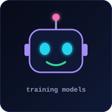

<!-- Generated by scripts/build.py from profile.json. Edit profile.json, not this file. -->

  <picture><source media="(prefers-color-scheme: dark)" srcset="assets/generated/hero-dark.svg"/><source media="(prefers-color-scheme: light)" srcset="assets/generated/hero-light.svg"/></picture>

<h1 align="center">Qasim Raza Malik</h1>

<b>Full-Stack Engineer (React · TypeScript · Node.js) · AI & Backend Developer · Data Analyst</b> Abbottabad, Pakistan · Remote · Open to Full-Stack, AI & Analytics Engineering roles

    

<picture><source media="(prefers-color-scheme: dark)" srcset="assets/generated/sticker-rocket-dark.svg"/><source media="(prefers-color-scheme: light)" srcset="assets/generated/sticker-rocket-light.svg"/></picture> <picture><source media="(prefers-color-scheme: dark)" srcset="assets/generated/sticker-robot-dark.svg"/><source media="(prefers-color-scheme: light)" srcset="assets/generated/sticker-robot-light.svg"/></picture> <picture><source media="(prefers-color-scheme: dark)" srcset="assets/generated/sticker-chai-dark.svg"/><source media="(prefers-color-scheme: light)" srcset="assets/generated/sticker-chai-light.svg"/></picture> <picture><source media="(prefers-color-scheme: dark)" srcset="assets/generated/sticker-radar-dark.svg"/><source media="(prefers-color-scheme: light)" srcset="assets/generated/sticker-radar-light.svg"/></picture>

<picture><source media="(prefers-color-scheme: dark)" srcset="assets/generated/divider-dark.svg"/><source media="(prefers-color-scheme: light)" srcset="assets/generated/divider-light.svg"/></picture>

## About me

I'm **Qasim Raza Malik**, a **full-stack software engineer and data analyst** from **Abbottabad, Pakistan**, working with **React, TypeScript, Node.js, Python and SQL**. I'm an **AI & Backend Developer at [Digital Experts Dev](https://digitalexperts.dev)**, building backend services and REST API integrations for AI-enabled web apps. Before that I was a **Full Stack Developer Intern at Axelliant**, and as a **freelance frontend developer at Lytnetwork** I delivered **30+ live business and e-commerce websites**. On the data side, I've worked remotely in **data roles at Blip, Stellar Tech (data engineering) and Scentbird (BI / data analyst)**, and I built the forecasting dashboard for **ForecastPro AI**, an e-commerce sales-prediction project. I hold a **BS in Computer Science** from **Abbottabad University of Science and Technology (AUST)** and I'm doing an **MS in Artificial Intelligence at COMSATS**. I also co-run **[Primeura Digital Solutions](https://primeura.com)**.

  <picture><source media="(prefers-color-scheme: dark)" srcset="assets/generated/terminal-dark.svg"/><source media="(prefers-color-scheme: light)" srcset="assets/generated/terminal-light.svg"/></picture>

## What I work on

- **Full-stack web apps:** React + TypeScript front ends with clean, reusable components
- **Backend & APIs:** Node.js, Express and PostgreSQL APIs that stay correct under concurrent load
- **Data analysis & BI:** SQL and Python analysis, dashboards, data visualisation and sales forecasting
- **Applied AI:** voice cloning, speech, RAG agents and computer vision, free to run on Colab
- **Creative tech:** motion graphics tooling, Three.js and browser games

## Featured projects

| Project | What it does | Built with |
|---|---|---|
| [**Voice Cloner**](https://github.com/qasimrazamalik-coder/voice-cloner) | Free, open-source Urdu + English voice cloning: studio, real-time streaming, speech-to-speech and LoRA fine-tuning. Runs free on Google Colab. | Python · PyTorch · Gradio · Whisper |
| [**Motion Forge**](https://github.com/qasimrazamalik-coder/motion-forge) | AI motion graphics and social video edits that check their own frames: kinetic type, promos, Reels/TikTok captions, DaVinci / Premiere / CapCut hand-off. | Claude Code skill · JavaScript |
| [**Encore Seat Booking API**](https://github.com/qasimrazamalik-coder/encore-seat-booking-api) | Event seat-booking API that never double-sells: expiring holds, all-or-nothing seat locking and idempotent checkout, proven by race tests. | Node.js · Express 5 · PostgreSQL |
| [**Ticker URL Shortener**](https://github.com/qasimrazamalik-coder/ticker-url-shortener) | URL shortener with analytics: Feistel short codes, cached redirects, batched click logging and cookie-free unique visitors. | Node.js · Express 5 · PostgreSQL |
| [**Platform Task Tracker API**](https://github.com/qasimrazamalik-coder/platform-task-tracker-api) | Project and task tracker API with per-project roles, four-eyes review, WIP limits, dependency cycle checks and flow metrics. | Node.js · Express 5 · PostgreSQL |
| [**Shelfmark Library API**](https://github.com/qasimrazamalik-coder/shelfmark-library-api) | Library circulation REST API: loans, renewals, hold queues and fines that stay correct under concurrent requests. | Node.js · Express 5 · PostgreSQL |
| [**Kaggle Data Scraper**](https://github.com/qasimrazamalik-coder/Kaggle-Data-Scraper) | Async scraper that collects Kaggle competition metadata, leaderboards, winners and solution write-ups into CSV for analysis. | Python · asyncio · aiohttp |
| [**Chain Reaction**](https://github.com/qasimrazamalik-coder/chain-reaction) | Browser 3D physics puzzle workshop: eight challenges, a creative sandbox and deterministic Rapier simulation. | TypeScript · Three.js · Rapier |
| [**AirSketch AI Pro**](https://github.com/qasimrazamalik-coder/AirSketch-AI-Pro) | AI gesture whiteboard: draw in the air with your hand, with voice commands and optional YOLO object detection. | Python · OpenCV · MediaPipe |

<picture><source media="(prefers-color-scheme: dark)" srcset="assets/generated/divider-dark.svg"/><source media="(prefers-color-scheme: light)" srcset="assets/generated/divider-light.svg"/></picture>

## Play my contribution graph

Every brick in this arcade game is a real day from my GitHub contribution graph. Busier days are brighter and take more hits. It has particles, combos, power-ups and synthesized sound effects, and runs in the browser with no libraries.

  <a href="https://qasimrazamalik-coder.github.io/qasimrazamalik-coder/game/"><picture><source media="(prefers-color-scheme: dark)" srcset="assets/generated/game-dark.svg"/><source media="(prefers-color-scheme: light)" srcset="assets/generated/game-light.svg"/></picture></a>

<a href="https://qasimrazamalik-coder.github.io/qasimrazamalik-coder/game/"><b>▶ Play Contribution Breakout</b></a> (sound on 🔊)

<picture><source media="(prefers-color-scheme: dark)" srcset="assets/generated/divider-dark.svg"/><source media="(prefers-color-scheme: light)" srcset="assets/generated/divider-light.svg"/></picture>

## GitHub at a glance

  <picture><source media="(prefers-color-scheme: dark)" srcset="assets/generated/stats-dark.svg"/><source media="(prefers-color-scheme: light)" srcset="assets/generated/stats-light.svg"/></picture>
  <picture><source media="(prefers-color-scheme: dark)" srcset="assets/generated/langs-dark.svg"/><source media="(prefers-color-scheme: light)" srcset="assets/generated/langs-light.svg"/></picture>

  <picture><source media="(prefers-color-scheme: dark)" srcset="assets/generated/activity-dark.svg"/><source media="(prefers-color-scheme: light)" srcset="assets/generated/activity-light.svg"/></picture>

  <picture><source media="(prefers-color-scheme: dark)" srcset="https://raw.githubusercontent.com/qasimrazamalik-coder/qasimrazamalik-coder/output/snake-dark.svg"/>
  </picture>

## Toolbox

`React` · `TypeScript` · `JavaScript` · `Node.js` · `Express` · `Python` · `SQL` · `PostgreSQL` · `MongoDB` · `pandas` · `Data visualisation` · `REST APIs` · `Tailwind CSS` · `Three.js` · `Docker` · `Git` · `Vercel`

## Let's work together

Hiring a **full-stack engineer, AI/backend developer or data analyst**, or need a web app, API, dashboard or AI tool built? Email me at **iamqasimrazamalik@gmail.com** or message me on [LinkedIn](https://www.linkedin.com/in/qasim-raza-malik-447274254).

Cards on this page are drawn by my own GitHub Action from live GitHub data, refreshed daily. No third-party stats services.
